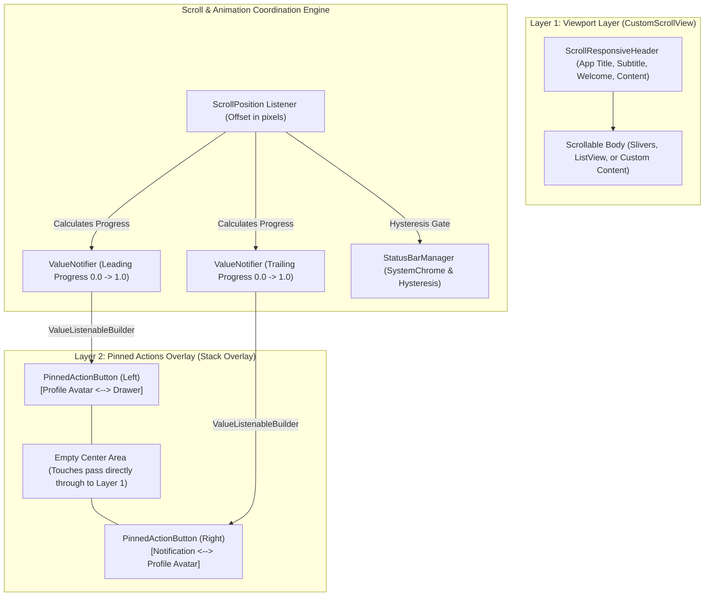

# ARCHITECTURE — Scroll-Responsive UI System

## 1. High-Level Architectural Design

The package provides a decoupled, layered architecture separating the **scrollable viewport** from the **pinned action overlay**, synchronized by a centralized, zero-rebuild scroll tracking pipeline.



---

## 2. Component Breakdown

### 2.1 `ScrollResponsiveScaffold`
The primary public orchestrator widget.
- Internally wraps a Flutter `Scaffold` and a `Stack`.
- Manages the lifecycle of an internal `ScrollController` (or cleanly attaches to a user-provided controller).
- Houses `ValueNotifier<double>` instances for leading and trailing progress.
- Mounts two distinct `Positioned` widgets for the left and right actions rather than a full-width container, guaranteeing that touches in the center and body pass directly to the scroll view without obstruction.
- Detects scroll direction using `NotificationListener<UserScrollNotification>` and dispatches updates via `onScrollDirectionChanged`.
- Emits real-time telemetry details via `onScrollUpdate` with a `ScrollProgressDetails` payload.

### 2.2 `ScrollResponsiveHeader`
A pre-built, flexible header widget that scrolls naturally away with the page.
- Designed with clear top insets (`padding: EdgeInsets.fromLTRB(16, 68, 16, 16)`) to clear the pinned actions bar in the initial state.
- Supports `title`, `subtitle`, `welcome`, `avatar`, `actions`, and arbitrary `content`.
- Background defaults to `Colors.transparent`, allowing custom styling and decorations without hardcoded borders or elevation.

### 2.3 `PinnedActionButton`
A dual-state action button with zero layout shifts.
- Fixed touch target dimensions (`touchTargetSize: Size(48.0, 48.0)`).
- Completely transparent background: no card, no border, no shadow, no blur, and no elevation.
- Stacks `initialWidget` and `scrolledWidget` inside a fixed bounding box.
- Supports customizable:
  - **Fade**: Opacity transitioning from $1.0 \rightarrow 0.0$ and $0.0 \rightarrow 1.0$.
  - **Scale**: Eased scaling between `minScale` (default $0.75$) and `maxScale` ($1.0$).
  - **Slide**: Eased directional vertical translation (`FractionalTranslation`).
- **Hit-Test Resolution**:
  - When normalized progress $t < 0.5$: Active callback is `onInitialTap`. The scrolled widget is wrapped in `IgnorePointer(ignoring: true)`.
  - When normalized progress $t \ge 0.5$: Active callback is `onScrolledTap`. The initial widget is wrapped in `IgnorePointer(ignoring: true)`.

### 2.4 `StatusBarManager`
Low-level controller for native mobile System Status Bar visibility.
- **Hysteresis Logic**:
  - Hides the status bar when `offset >= statusBarHideOffset` (default 100px).
  - Restores the status bar when `offset <= statusBarShowOffset` (default 50px).
  - Prevents status bar fluttering when the user scrolls near the threshold boundary.
- **Non-Spamming Guarantee**: State changes occur strictly on crossing thresholds, completely eliminating redundant per-frame platform channel invocations.
- **Content Jump Prevention**: Caches the maximum observed top padding (`MediaQuery.padding.top`), so when the status bar hides, the pinned action icons stay fixed at their coordinate instead of snapping upward by 24–44px.
- **Platform Safety**: Wraps all `SystemChrome` calls in try/catch blocks and checks `!kIsWeb && (Platform.isAndroid || Platform.isIOS)` to ensure non-mobile platforms (Web, Windows, macOS, Linux) run without throwing exceptions.
- **Safe Restoration**: Restores initial system UI state in `dispose()`.

---

## 3. Configuration System

Configuration is organized into modular, immutable data classes:

```
ScrollResponsiveConfig
├── ScrollThresholdConfig
│   ├── leadingStartOffset (20.0)
│   ├── leadingEndOffset (80.0)
│   ├── trailingStartOffset (20.0)
│   ├── trailingEndOffset (80.0)
│   ├── statusBarHideOffset (100.0)
│   └── statusBarShowOffset (50.0)
├── ScrollAnimationConfig
│   ├── transitionType (scrollProgress | thresholdTriggered)
│   ├── duration (250ms)
│   ├── curve (easeInOut)
│   ├── minScale (0.75)
│   ├── maxScale (1.0)
│   ├── slideOffset (Offset(0.0, 0.15))
│   ├── enableFade (true)
│   ├── enableScale (true)
│   ├── enableSlide (true)
│   └── enableReverseAnimation (true)
├── StatusBarConfig
│   ├── enabled (true)
│   ├── hideOnScroll (true)
│   ├── preventContentJump (true)
│   ├── hiddenUiMode (manual)
│   ├── hiddenOverlays ([bottom])
│   ├── visibleUiMode (edgeToEdge)
│   ├── visibleOverlays (values)
│   └── restoreOnDispose (true)
└── PinnedActionsConfig
    ├── pinned (true)
    ├── transparentBackground (true)
    ├── height (56.0)
    ├── padding (EdgeInsets(16, 8))
    ├── touchTargetSize (Size(48, 48))
    └── safeArea (true)
```

---

## 4. Performance & Controller Ownership Strategy

### 4.1 Selective Rebuilding Architecture
A major issue with naive scroll animations in Flutter is calling `setState()` on every scroll frame, which rebuilds the entire widget tree (including large lists and expensive widgets).
- In `app_bar_ui`, the scroll listener only updates `_leadingProgressNotifier.value` and `_trailingProgressNotifier.value`.
- Only the two small `PinnedActionButton` widgets are wrapped in `ValueListenableBuilder<double>`.
- The `CustomScrollView`, `header`, and `body` are **never rebuilt on scroll ticks**, running directly on Flutter's C++ render pipeline at 60/120 FPS.

### 4.2 Controller Ownership & Memory Management
- **ScrollController**:
  - If the user provides a `controller`, the scaffold uses it without taking ownership and **does not dispose it** in `dispose()`.
  - If omitted, an internal `ScrollController` is instantiated in `initState()` and disposed in `dispose()`.
  - In `didUpdateWidget()`, changes in `widget.controller` properly migrate listeners without memory leaks.
- **AnimationControllers**:
  - When `transitionType == ScrollTransitionType.thresholdTriggered`, internal `AnimationController`s are instantiated with `TickerProviderStateMixin` and disposed in `dispose()`.
- **SystemChrome**:
  - Restores initial system overlays in `dispose()` to guarantee the user's host application is returned to its pristine state.

