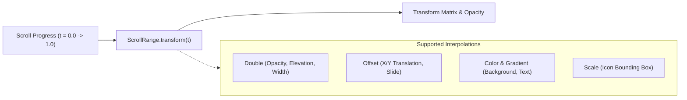

# ARCHITECTURE — Scroll-Driven UI Framework for Flutter

## 1. High-Level Architectural Overview

The framework employs a **decoupled, multi-layered reactive architecture** that cleanly isolates scroll position observation, state calculation, rendering pipelines, and native operating system integration.

```mermaid
flowchart TD
    subgraph Client["Developer Application Layer"]
        Preset["ScrollResponsivePresets (material, ios, minimal, etc.)"]
        Config["ScrollResponsiveConfig / SmartVisibilityConfig"]
        Controller["ScrollResponsiveController (extends ScrollController)"]
    end

    subgraph CoreEngine["Engine & Coordination Layer"]
        ScrollEngine["ScrollResponsiveEngine (Offset, Velocity, Direction)"]
        VisController["SmartVisibilityController (Per-Target Notifiers)"]
        SnapEngine["ScrollSnapEngine / ScrollSnapPhysics"]
        StatusManager["StatusBarManager (Native SystemChrome & Hysteresis)"]
    end

    subgraph AnimationLayer["Unified Animation Layer"]
        ScrollRange["ScrollRange<T> (Double, Offset, Color)"]
        ScrollTransform["ScrollTransform (Opacity, Scale, Slide, Rotation)"]
        ScrollColor["ScrollColorTransition (Color & Gradient Tweening)"]
        ScrollMorph["ScrollMorphBuilder (Midpoint Switching & Cross-Fade)"]
    end

    subgraph WidgetLayer["Modular Public UI Layer"]
        ScaffoldWidget["ScrollResponsiveScaffold (Master Orchestrator)"]
        PinnedActions["PinnedActionButton (Dual-State Actions)"]
        HeaderWidget["ScrollResponsiveHeader / ScrollCollapsingHeader"]
        AuxiliaryWidgets["ScrollStickyTabBar | ScrollAwareFab | ScrollAutoHideBottomBar | ScrollProgressIndicator | ScrollParallax | ScrollSectionReveal"]
    end

    Client -->|Configures & Controls| CoreEngine
    CoreEngine -->|Drives Normalized Progress| AnimationLayer
    AnimationLayer -->|Renders Without Tree Rebuilds| WidgetLayer
```



---

## 2. Core Engine Architecture

### 2.1 Centralized Scroll Engine (`ScrollResponsiveEngine`)
The engine serves as the single source of truth for all scroll dynamics.
- **Scroll Position & Normalized Progress**: Tracks `pixels`, `maxScrollExtent`, and maps offset to progress $t \in [0.0, 1.0]$ between `startOffset` and `endOffset`.
- **Direction & Velocity Tracking**: Intercepts `UserScrollNotification` and `ScrollUpdateNotification` to identify `ScrollDirection.idle`, `forward` (up), or `reverse` (down).
- **Hysteresis Boundary Evaluation**: Decouples forward hide thresholds from reverse show thresholds to eliminate oscillation flutter.
- **Axis Discrimination**: Specifically filters for `Axis.vertical` notifications (`notification.metrics.axis == Axis.vertical`), guaranteeing that horizontal inner carousels or tab views never interfere with vertical header transitions.
- **Selective Notification Dispatch**: Uses dedicated `ValueNotifier<double>` streams (`leadingProgressNotifier`, `trailingProgressNotifier`, `statusBarNotifier`) rather than calling `setState` on the entire scaffold.

### 2.2 Unified Controller (`ScrollResponsiveController`)
- **Direct `ScrollController` Inheritance**: Extends Flutter's `ScrollController`, making it 100% drop-in compatible with any standard scroll view.
- **Programmatic Control Suite**:
  - `scrollToTop({Duration duration, Curve curve})`
  - `scrollToBottom({Duration duration, Curve curve})`
  - `collapseHeader({Duration duration, Curve curve})`
  - `expandHeader({Duration duration, Curve curve})`
  - `snapTo(double offset, {Duration duration, Curve curve})`
- **Internal Smart Visibility Coordination**: Integrates a `SmartVisibilityController` instance, exposing `.visibilityController` and `setVisibility(target, visibility)` directly to developers.

### 2.3 Smart Visibility Controller (`SmartVisibilityController`)
Centralized visibility manager governing 7 distinct target UI elements:
```dart
enum VisibilityTarget {
  header,
  leftAction,
  rightAction,
  floatingActionButton,
  bottomNavigationBar,
  stickyTab,
  statusBar,
}
```
- **Independent Thresholds & Rules**: Each target maintains an independent `VisibilityRule` defining `hideOffset`, `showOffset`, `hideOnScrollDown`, `showOnReverseScroll`, `priority`, and `duration`.
- **Granular Streams**: Exposes `visibilityNotifier(VisibilityTarget)` providing `ValueListenable<double>` so widgets (such as a FAB or Bottom Bar) only listen to their own visibility stream.

### 2.4 Native System UI Manager (`StatusBarManager`)
- **Direct Native Control**: Interacts with `SystemChrome.setEnabledSystemUIMode` and `SystemChrome.setSystemUIOverlayStyle`.
- **Serialization Lock Queue**: Chains asynchronous system calls sequentially via an internal completion future (`Future<void> _pendingOperation`) to avoid race conditions during rapid velocity flings.
- **Route Lifecycle Awareness**: Subscribes to `RouteAware` via `RouteObserver` to automatically restore the native status bar on route pushes and re-apply scroll state on route pops.
- **App Lifecycle Handling**: Implements `WidgetsBindingObserver` to synchronize the native status bar when the app resumes from the background.
- **Safe Fallbacks**: Automatically checks `!kIsWeb && (Platform.isAndroid || Platform.isIOS)` to ensure desktop and web platforms no-op gracefully without platform channel exceptions.

---

## 3. Unified Animation Engine

To avoid creating duplicate `AnimationController`s for every widget, the framework provides a **declarative, scroll-linked animation system**:



### 3.1 `ScrollRange<T>`
An immutable range model mapping normalized scroll progress $[beginProgress, endProgress]$ to values of type `T` (`double`, `Offset`, `Color`) with customizable `Curve` interpolation.

### 3.2 `ScrollTransform`
A multi-property transform container supporting:
- Scroll-linked opacity
- Scroll-linked scale
- Scroll-linked translation ($X$ and $Y$)
- Scroll-linked rotation
- **Reduced Motion Awareness**: Automatically checks `MediaQuery.maybeDisableAnimationsOf(context)`. When a user requests reduced motion at the OS level, scale, slide, and rotation are automatically bypassed.

### 3.3 `ScrollColorTransition`
Interpolates colors (`Color.lerp`) or gradients (`Gradient.lerp`) based on scroll progress with boundary optimizations.

### 3.4 `ScrollMorphBuilder`
Cross-fades and transforms between an `initialChild` and a `scrolledChild` at a configured `switchPoint` (default 0.5) with midpoint hit-test switching.

---

## 4. Modular Public Component Hierarchy

### 4.1 Master Scaffold: `ScrollResponsiveScaffold`
Combines:
- Layer 1: Naturally scrolling `CustomScrollView` (header sliver, optional sticky tab sliver, body slivers).
- Layer 2: Pinned actions overlay (`PinnedActionButton` for left and right with transparent background).
- Layer 3: Reading progress indicator overlay (`ScrollProgressIndicator`).
- Scaffold Slots: `floatingActionButton` (with optional `scrollAwareFab: true`), `bottomNavigationBar` (with optional `autoHideBottomBar: true`), and drawer controls.

### 4.2 Header Components
- `ScrollResponsiveHeader`: Standard scroll-away header with title, subtitle, welcome, and avatar.
- `ScrollCollapsingHeader`: Persistent sliver collapsing from `expandedHeight` to `collapsedHeight` with builder support.
- `ScrollPullToExpandHeader`: Rubber-band stretch and zoom header responding to top overscroll.

### 4.3 Navigation & Auxiliary Components
- `ScrollStickyTabBar`: Pinned persistent sliver tab bar adapting elevation and border when pinned.
- `ScrollAwareFab`: Scroll-aware floating action button with scale/slide transitions and extended cross-fade.
- `ScrollAutoHideBottomBar`: Slide-down auto-hiding footer container.
- `ScrollParallax`: 60/120 FPS `Flow`-based parallax container repainting without widget rebuilds.
- `ScrollProgressIndicator`: Linear reading bar or circular scroll indicator.
- `ScrollSectionReveal`: Viewport-entry animated reveal with stagger and reduced-motion compliance.

---

## 5. Developer Experience & Presets

The framework offers ready-to-use presets via `ScrollResponsivePresets`:
1. `ScrollResponsivePresets.material()`: Balanced thresholds, Material curves, status bar sync enabled.
2. `ScrollResponsivePresets.minimal()`: Light, fast fade, status bar sync disabled by default.
3. `ScrollResponsivePresets.iosInspired()`: Bouncing physics, cubic easing, wider hysteresis thresholds.
4. `ScrollResponsivePresets.collapsingHeader()`: Accommodates large 200px+ hero banners.
5. `ScrollResponsivePresets.transparentFloating()`: Floating actions only, clean content scroll.
6. `ScrollResponsivePresets.dashboard()`: Configured for dense tabbed dashboard layouts.
7. `ScrollResponsivePresets.custom()`: Full fine-tuning capability.

---

## 6. Testing & Quality Strategy

Every module is protected by automated tests across:
1. **Unit Tests**: Threshold arithmetic, boundary assertions, preset validity, range interpolation, copyWith methods.
2. **Widget Tests**: Rendering, layout constraints, midpoint hit-testing, tap callbacks, transparency verification, drawer opening.
3. **Scroll & Direction Tests**: Forward scroll, reverse scroll restoration, hysteresis stability, horizontal scroll isolation.
4. **Integration Tests**: Route transitions (`RouteObserver`), app lifecycle transitions (`WidgetsBindingObserver`), status bar hiding/restoring, controller disposal.
5. **Accessibility Tests**: Reduced-motion verification (`disableAnimations: true`), semantic labels.
