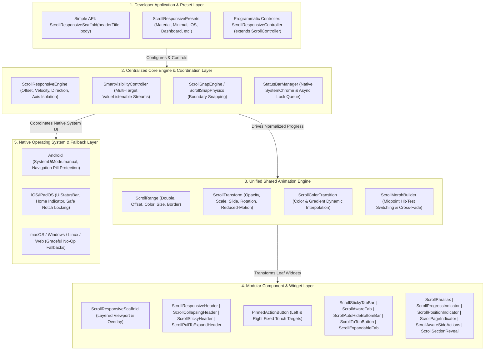
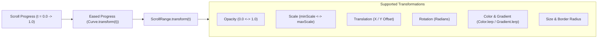
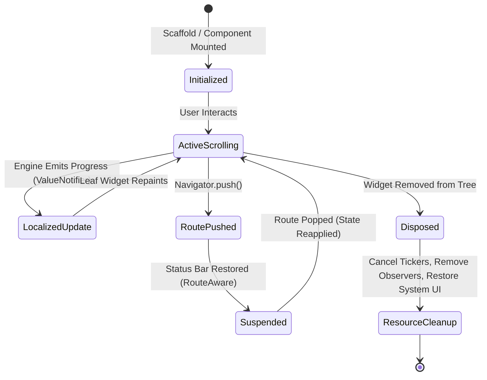

# ARCHITECTURE — Scroll-Driven UI Framework for Flutter

## 1. High-Level Architectural Design & Layering

The framework employs a **decoupled, multi-layered reactive architecture** that cleanly separates developer configuration, low-level scroll physics, state calculation, unified animation transformation, and platform-specific operating system channels.



---

## 2. Core Scroll Engine Architecture

### 2.1 Centralized Scroll Engine (`ScrollResponsiveEngine`)
The engine operates as the single source of truth for all scroll dynamics across the framework.
- **Scroll Tracking & Progress Calculation**: Continuously maps raw scroll offsets $[pixels]$ to a normalized domain $t \in [0.0, 1.0]$ between configurable start and end thresholds (`leadingStartOffset` $\to$ `leadingEndOffset`, `trailingStartOffset` $\to$ `trailingEndOffset`).
- **Velocity & Direction Tracking**: Intercepts `UserScrollNotification` and `ScrollUpdateNotification` to calculate real-time velocity and directional states (`ScrollDirection.idle`, `forward` [scrolling up/towards top], or `reverse` [scrolling down]).
- **Vertical Axis Discrimination**: Strictly checks `notification.metrics.axis == Axis.vertical`. Any inner horizontal scroll views (e.g., horizontal product carousels, swipeable tabs) are completely isolated, ensuring they never trigger unwanted header collapsing or status bar transitions.
- **Multiple Scroll Regions & Nested Scrolling**: Supports nested scroll structures (`NestedScrollView`, inner slivers) via notification bubbling depth management without conflicting with inner scroll extents.
- **Scroll State Restoration**: Supports standard `PageStorageKey` and `keepScrollOffset` to preserve and restore scroll positions across route transitions and tab switching.
- **Selective Localized Notification Streams**: Eliminates full widget tree rebuilds by driving independent `ValueNotifier<double>` streams (`leadingProgressNotifier`, `trailingProgressNotifier`, `statusBarNotifier`).

### 2.2 Programmatic Controller (`ScrollResponsiveController`)
- **Direct `ScrollController` Inheritance**: Extends Flutter's `ScrollController`, maintaining 100% backward and drop-in compatibility with standard widgets.
- **Programmatic Control Methods**:
  - `scrollToTop({Duration duration, Curve curve})`
  - `scrollToBottom({Duration duration, Curve curve})`
  - `collapseHeader({Duration duration, Curve curve})`
  - `expandHeader({Duration duration, Curve curve})`
  - `snapTo(double offset, {Duration duration, Curve curve})`
- **Telemetry Getters**: Real-time inspection via `progress` ($0.0 \to 1.0$), `offset` (pixels), and `direction` (`ScrollDirection`).
- **Lifecycle Guarantees**: Coordinates controller attachment, client verification (`hasClients`), and safe cleanup of attached visibility engines.

---

## 3. Unified Animation Engine

To avoid instantiating multiple uncoordinated `AnimationController`s across widgets, the framework provides a **declarative, shared animation architecture**:



### 3.1 Declarative Animation Models
- **`ScrollRange<T>`**: Maps normalized progress $[beginProgress, endProgress]$ to values of type `T` (`double`, `Offset`, `Color`) with customizable forward and reverse easing curves.
- **`ScrollTransform`**: A composite transform container that simultaneously applies opacity, scale, $X/Y$ translation, and rotation without nesting multiple render objects.
- **`ScrollColorTransition`**: Interpolates colors (`Color.lerp`) and linear/radial gradients (`Gradient.lerp`) based on scroll progress with boundary clamping optimizations.
- **`ScrollMorphBuilder`**: Smoothly cross-fades and scales between an initial child and a scrolled child, automatically switching hit-testing at a configurable midpoint (default $0.5$).
- **Reduced-Motion Accessibility Mode**: Automatically queries `MediaQuery.maybeDisableAnimationsOf(context)`. When a user enables reduced motion in their OS accessibility settings, aggressive translation, scale, and rotation are automatically suppressed while preserving accessibility and functionality.

---

## 4. Smart Visibility Controller (`SmartVisibilityController`)

The framework features a centralized visibility engine that coordinates UI components independently:

### 4.1 Governed Visibility Targets
```dart
enum VisibilityTarget {
  header,
  leftAction,
  rightAction,
  floatingActionButton,
  bottomNavigationBar,
  stickyTab,
  statusBar,
}
```

### 4.2 Independent Visibility Rules (`VisibilityRule`)
Each target is governed by an independent rule specifying:
- `hideOffset`: Scroll offset in pixels at or beyond which the target hides.
- `showOffset`: Scroll offset in pixels at or below which the target shows (hysteresis gate).
- `hideOnScrollDown`: Whether downward scrolling conceals the target.
- `showOnReverseScroll`: Whether upward reverse scrolling restores visibility.
- `priority`: Evaluation precedence when multiple conflicting gestures occur.
- `duration` & `curve`: Animation parameters for triggered visibility changes.

### 4.3 Zero-Cross-Talk Guarantee
Visibility updates to one target (e.g., hiding the FAB) are delivered solely to that target's dedicated `ValueNotifier<double>` stream. Sibling elements (e.g., sticky tabs or bottom navigation) do not rebuild or recalculate layout unless their own rules dictate.

---

## 5. Native System UI Management (`StatusBarManager`)

### 5.1 Platform Integration Strategy
- **Android**: Calls `SystemChrome.setEnabledSystemUIMode(SystemUiMode.manual, overlays: [SystemUiOverlay.bottom])`. Preserves Android 3-button navigation and gesture navigation pills while hiding the top status bar.
- **iOS / iPadOS**: Hides and restores `UIStatusBar` natively while maintaining the Home Indicator.
- **Content Jump Prevention (`preventContentJump`)**: Tracks maximum observed top padding (`MediaQuery.padding.top`). When the native status bar disappears, top insets are locked so page content does not jump awkwardly towards the notch.
- **Hysteresis Boundary Gating**: `statusBarHideOffset` (e.g. 100px) and `statusBarShowOffset` (e.g. 50px) ensure that scrolling back and forth near the boundary never causes rapid, distracting status bar flashing.
- **Asynchronous Serialization Queue**: Queues `SystemChrome` calls sequentially through a task lock future, eliminating platform race conditions during rapid velocity flings.
- **Route & Lifecycle Safety**:
  - `RouteAware`: Automatically restores the status bar when a new route is pushed, and re-applies the scroll-driven state when popped back.
  - `WidgetsBindingObserver`: Resynchronizes status bar visibility upon `AppLifecycleState.resumed`.
  - Disposal: Safely restores the original system UI mode and styles.

---

## 6. Developer-Friendly API Architecture

The framework provides two distinct tiers of API:

### 6.1 Simple Tier (Zero Boilerplate)
For standard use cases, developers write clean, declarative code with zero listener or animation management:
```dart
ScrollResponsiveScaffold(
  headerTitle: Text('Good Morning'),
  headerSubtitle: Text('John Doe'),
  initialLeading: CircleAvatar(child: Text('JD')),
  scrolledLeading: Icon(Icons.menu),
  initialTrailing: Icon(Icons.notifications),
  scrolledTrailing: CircleAvatar(child: Text('JD')),
  body: MyListView(),
)
```

### 6.2 Advanced Tier (Deep Customization)
For complex application architectures:
- Custom `ScrollResponsiveController` for programmatic control.
- `ScrollResponsivePresets` (`material`, `minimal`, `iosInspired`, `collapsingHeader`, `transparentFloating`, `dashboard`, `custom`).
- Dedicated widget slots: `stickyTabBar`, `progressIndicator`, `scrollAwareFab`, `autoHideBottomBar`.
- Custom sliver pipelines via `slivers: [...]`.

---

## 7. Modular Feature Components Architecture

| Component | Class Name | Architectural Pattern | Primary Purpose |
|---|---|---|---|
| **Collapsing Header** | `ScrollCollapsingHeader` | `SliverPersistentHeader` | Smooth collapse from `expandedHeight` to `collapsedHeight` with builder support |
| **Pull-to-Expand Header** | `ScrollPullToExpandHeader` | `SliverPersistentHeader` + Stretch | Rubber-band overscroll zoom and stretch for profile and hero covers |
| **Sticky Tab Bar** | `ScrollStickyTabBar` | `SliverPersistentHeader` (Pinned) | Pinned navigation tab bar adapting elevation and borders when stuck |
| **Scroll-Aware FAB** | `ScrollAwareFab` | Animated State + Transition | Conceals FAB on downward scroll; cross-fades extended vs compact styles |
| **Auto-Hide Bottom Bar** | `ScrollAutoHideBottomBar` | Fractional Translation + Align | Slides bottom navigation bar downward offscreen during downward scroll |
| **Parallax Container** | `ScrollParallax` | `Flow` + `FlowDelegate` | 60/120 FPS high-performance parallax repainting without widget rebuilds |
| **Snap Engine** | `ScrollSnapEngine` / `ScrollSnapPhysics` | `ScrollPhysics` + Ballistic Simulation | Magnetically snaps scroll view to header or custom section boundaries |
| **Reading Progress** | `ScrollProgressIndicator` | Value Listenable + LayoutBuilder | Visual depth indicator (linear top reading bar or circular widget) |
| **Section Reveal** | `ScrollSectionReveal` | Viewport Detection + Animation | Triggers staggered fade/slide-up entrance as sections enter viewport |

---

## 8. Memory & Resource Lifecycle Management



- **Single Owner Principle**: Controllers created internally by widgets are disposed internally; controllers passed externally by developers are left for the developer to dispose.
- **Listener Unsubscription**: All `RouteObserver`, `WidgetsBindingObserver`, and `ValueNotifier` listeners are unsubscribed inside `State.dispose()`.
- **Zero Leak Guarantee**: Comprehensive automated tests verify that widget disposal leaves zero dangling references or unfinished platform channel futures.
